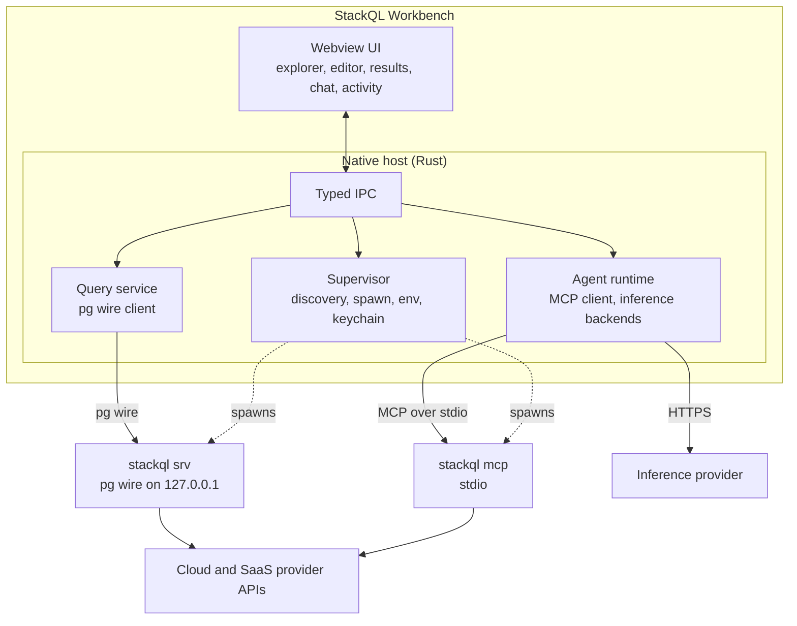
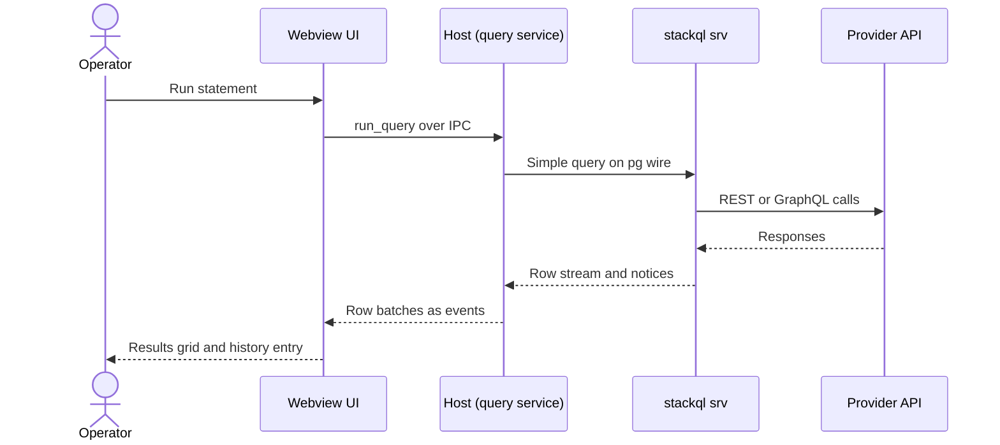
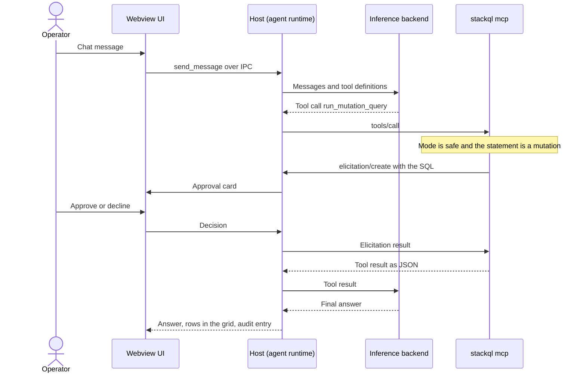
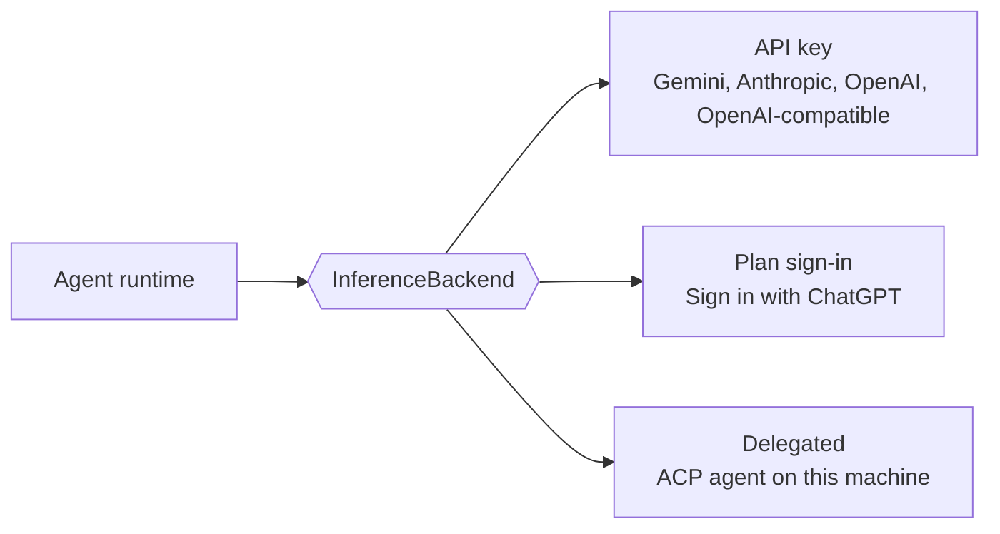
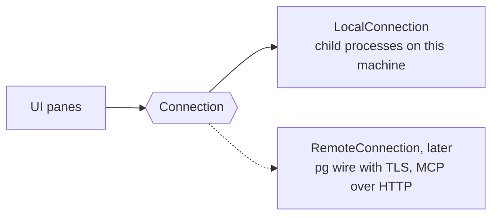

# StackQL Workbench

Desktop query IDE and chat interface for [StackQL](https://github.com/stackql/stackql), for Windows and macOS.

Status: pre-alpha. The design is settled and M0 is the current milestone. Nothing here is released yet.

## Overview

StackQL Workbench is a native desktop app that runs against the `stackql` engine installed on the same machine. It gives an operator two ways to work with cloud and SaaS providers as data sources accessed via SQL: a query IDE for statements they write themselves, and a chat interface in which a model proposes and runs statements under the engine's safety controls.

The planned capabilities are listed below.

- Provider explorer: a lazy tree of providers, services, resources, methods and fields
- Query editor: tabs, StackQL-aware completion, saved `.iql` files
- Results grid: virtualised rows, JSON cell viewer, export
- Chat: available when an inference backend is configured, hidden otherwise
- Approvals and activity: mutations proposed by a model wait for the operator, and every agent action is logged
- Settings: engine path, credentials profile, safety mode, inference backend

## Architecture

The app is a webview UI over a native host. The host owns every process, connection and secret. The webview is not served over HTTP and opens no network listener.



### Engine channels

The host reaches the engine over two channels with different trust levels. They are kept separate on purpose.

| Channel | Process | Transport | Used by | Statements come from |
|---|---|---|---|---|
| Human | `stackql srv` | Postgres wire protocol on 127.0.0.1 | Explorer, editor | The operator |
| Agent | `stackql mcp` | MCP over stdio | Agent runtime | A model |

### Running a statement from the editor

Statements the operator runs go straight down the human channel. Rows stream back to the grid in batches.



### A chat turn with an approval

Statements a model proposes go down the agent channel. The MCP server classifies each statement and, depending on the safety mode, asks the operator for approval through the host before running it.



### Safety modes

The workspace safety setting is passed to the MCP server as `server.mode`. The engine does the classification and the gating; the app only renders the approval.

| Mode | SELECT and metadata | INSERT, UPDATE, REPLACE | DELETE | EXEC |
|---|---|---|---|---|
| `read_only` | allow | refuse | refuse | refuse |
| `safe` (default) | allow | needs approval | needs approval | needs approval |
| `delete_safe` | allow | allow | needs approval | needs approval |
| `full_access` | allow | allow | allow | allow |

### Inference backends

Chat is optional. When it is enabled, the agent runtime talks to a model through one interface with several backends behind it.



The backends differ in how the operator signs in and in who runs the agent loop.

| Backend | Sign-in | Agent loop | MCP client |
|---|---|---|---|
| API key | Key held in the OS keychain | Host | Host |
| Plan sign-in | Sign in with ChatGPT | Host | Host |
| Delegated | Whatever the installed ACP agent already uses | The agent | The agent |

### Connections

All engine access sits behind one interface. The first releases work only with the local engine. Connecting to a remote StackQL server comes later and does not change the UI.



## Credentials

Provider credentials are environment variables read by the engine, as they are for the `stackql` CLI. The host builds the environment for the engine processes from values in the OS keychain or from a dotenv file the operator points at. The UI shows which variables are set and never shows their values.

## Development

The commands below apply once M0 has landed.

Prerequisites:

- Rust stable toolchain
- Node.js LTS
- The [Tauri 2 prerequisites](https://v2.tauri.app/start/prerequisites/) for your platform
- A `stackql` binary on `PATH`, or its location in the `STACKQL_BIN` environment variable

```
npm install
npm run tauri dev
```

Checks:

```
npm run lint
npm run typecheck
npm test

cd src-tauri
cargo fmt --check
cargo clippy --all-targets -- -D warnings
cargo test
```

## Repository layout

The intended layout is shown below.

```
stackql-workbench/
  src/                  webview (React)
    panes/              explorer, editor, results, chat, activity, settings
    host/               typed wrappers over IPC
  src-tauri/            host (Rust)
    src/
      engine/           discovery, supervisor, process lifecycle
      connection/       Connection trait, LocalConnection
      query/            pg wire client, row streaming, cancel
      agent/            MCP client, InferenceBackend trait, backends, loop
      secrets/          keychain access
      config/           settings and workspaces
      ipc/              command and event definitions
  docs/                 design notes and spike reports
```

## Roadmap

Milestones are delivered in order. Each one leaves the app in a usable state.

| Milestone | Scope |
|---|---|
| M0 Foundations | App scaffold, engine discovery and supervision, pg wire spike, provider explorer, single editor and results grid, CI on Windows and macOS |
| M1 Query IDE | Editor tabs, completion from provider metadata, streaming grid with JSON cell viewer, cancel, history, saved `.iql` files, export |
| M2 Packaging | Signed artefacts consumed by the StackQL MSI and PKG builds, version pinning, first IDE-only release |
| M3 Chat | Agent loop, stdio MCP client with approvals, activity pane, Gemini API key backend, inference settings |
| M4 More backends | Anthropic, OpenAI and OpenAI-compatible keys, Sign in with ChatGPT |
| M5 Delegated agents | ACP backend for agents already installed on the machine |
| Later | Remote connection to a StackQL server |

## Packaging

StackQL Workbench has no installer of its own. It ships inside the StackQL installers, beside the `stackql` binary.

- Windows: the StackQL MSI installs `stackql-workbench.exe` next to `stackql.exe` and adds a Start Menu entry. The app needs the Microsoft WebView2 runtime, which is present on Windows 11.
- macOS: the StackQL PKG installs `StackQL Workbench.app` to `/Applications` alongside the `stackql` CLI.
- Bundle identifier: `io.stackql.workbench`.
- This repository builds the per-platform artefacts. The StackQL release workflow consumes a pinned Workbench version.

## Prior art

Two earlier prototypes informed the layout and the API shape. Neither is used at runtime.

- [stackql-playground](https://github.com/stackql/stackql-playground): a browser UI with an explorer tree, an editor and a results grid
- [stackql-middleware](https://github.com/stackql/stackql-middleware): an HTTP layer over `stackql srv`

## Licence

MIT, the same as `stackql`. See [LICENSE](LICENSE).
