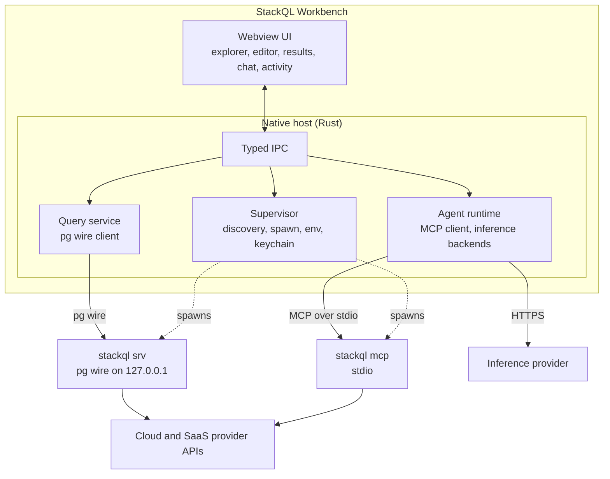
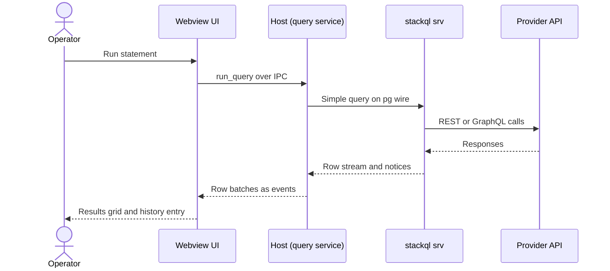
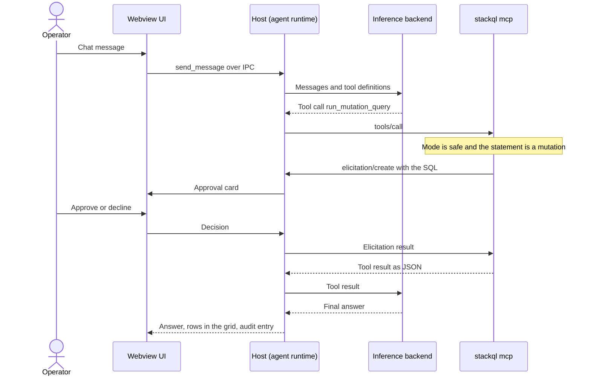
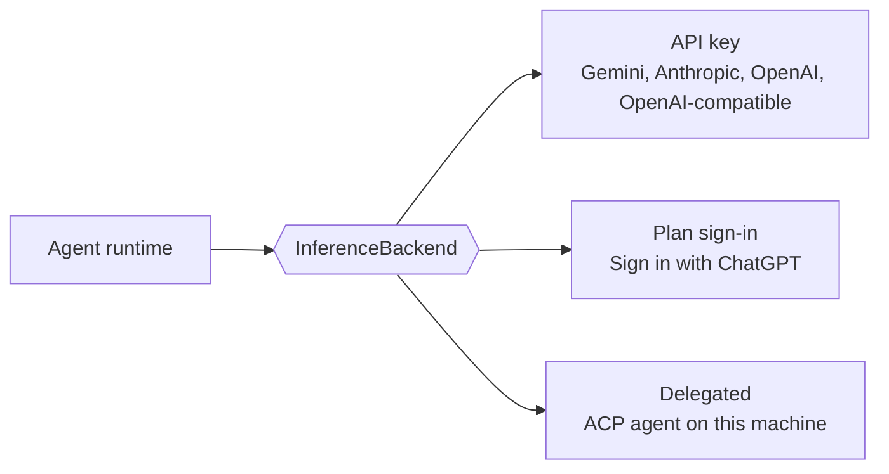
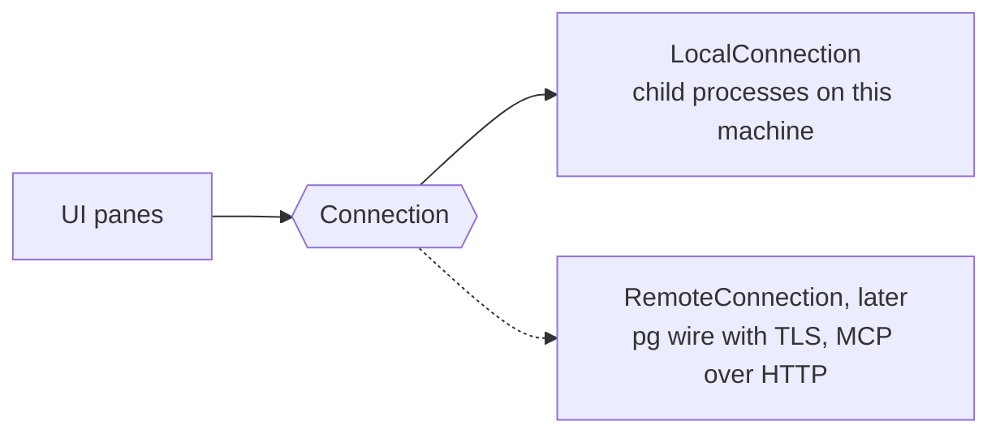

# StackQL Workbench

Desktop query IDE and chat interface for [StackQL](https://github.com/stackql/stackql), for Windows and macOS.

Status: pre-alpha. The query IDE foundations (M0), the core of chat (M3) and chat through the GitHub Copilot CLI work on Windows. Nothing here is released yet. On macOS the tests pass in CI and CI builds a test build, but the app has not been opened on a Mac.

## Overview

StackQL Workbench is a native desktop app that runs against the `stackql` engine installed on the same machine. It gives an operator two ways to work with cloud and SaaS providers as data sources accessed via SQL: a query IDE for statements they write themselves, and a chat interface in which a model proposes and runs statements under the engine's safety controls.

The planned capabilities are listed below.

- Provider explorer: a lazy tree of providers, services, resources, methods and fields
- Query library: the published library of working statements, grouped by use case, to open in the editor
- Query editor: tabs, StackQL-aware completion, saved `.iql` files
- Results grid: virtualised rows, sorting by column, JSON cell viewer, export
- Chat: the view the app opens in. It needs a model backend, and asks for one the first time a message is sent
- Answers with results: a turn is shown as its answer, with the result set as a table that sorts and downloads, and as a chart when one is asked for
- Approvals and activity: mutations proposed by a model wait for the operator, and every agent action is logged
- Settings: engine path, credentials profile, safety mode, inference backend

## Architecture

The app is a webview UI over a native host. The host owns every process, connection and secret. The webview is not served over HTTP and opens no network listener.



### Engine channels

The host reaches the engine over two channels with different trust levels. They are kept separate on purpose.

| Channel | Process | Transport | Used by | Statements come from |
|---|---|---|---|---|
| Human | `stackql srv` | Postgres wire protocol on 127.0.0.1 | Explorer, editor | The operator |
| Agent | `stackql mcp` | MCP over stdio | Agent runtime | A model |

### Running a statement from the editor

Statements the operator runs go straight down the human channel. Rows stream back to the grid in batches.



### A chat turn with an approval

Statements a model proposes go down the agent channel. The MCP server classifies each statement and, depending on the safety mode, asks the operator for approval through the host before running it.



### Safety modes

The workspace safety setting is passed to the MCP server as `server.mode`. The engine does the classification and the gating; the app only renders the approval.

| Mode | SELECT and metadata | INSERT, UPDATE, REPLACE | DELETE | EXEC |
|---|---|---|---|---|
| `read_only` | allow | refuse | refuse | refuse |
| `safe` (default) | allow | needs approval | needs approval | needs approval |
| `delete_safe` | allow | allow | needs approval | needs approval |
| `full_access` | allow | allow | allow | allow |

### Inference backends

Chat is optional. When it is enabled, the agent runtime talks to a model through one interface with several backends behind it.



The delegated backend that exists today is the GitHub Copilot CLI. It runs with the sign-in the CLI already has, which the app never sees, and it is given the engine's tools and nothing else. It cannot pass the engine's approval prompt on, so with it a statement that needs approval is refused instead of asked about. The findings behind this are in [docs/spike-acp.md](docs/spike-acp.md).

The backends differ in how the operator signs in and in who runs the agent loop.

| Backend | Sign-in | Agent loop | MCP client |
|---|---|---|---|
| API key | Key held in the OS keychain | Host | Host |
| Plan sign-in | Sign in with ChatGPT | Host | Host |
| Delegated | Whatever the installed ACP agent already uses | The agent | The agent |

### Connections

All engine access sits behind one interface. The first releases work only with the local engine. Connecting to a remote StackQL server comes later and does not change the UI.



## Credentials

Provider credentials are environment variables read by the engine, as they are for the `stackql` CLI. The host builds the environment for the engine processes from values in the OS keychain or from a dotenv file the operator points at. The UI shows which variables are set and never shows their values.

## Development

These steps were run on Windows 11.

Prerequisites:

- Rust stable toolchain, 1.90 or later, from rustup
- Node.js LTS
- The [Tauri 2 prerequisites](https://v2.tauri.app/start/prerequisites/) for your platform
- A `stackql` binary on `PATH`, or its location in the `STACKQL_BIN` environment variable

```
npm install
npm run tauri dev
```

To build the executable without an installer:

```
npm run tauri build -- --no-bundle
```

On Windows that produces `src-tauri/target/release/stackql-workbench.exe`.

Checks:

```
npm run lint
npm run typecheck
npm test

cd src-tauri
cargo fmt --check
cargo clippy --all-targets -- -D warnings
cargo test
```

The integration tests start a real `stackql` and are skipped when none is found. They need no cloud credentials and no network.

### Test build for macOS

CI builds the app for macOS on every run and keeps the disk image as the workflow artifact `stackql-workbench-macos-universal`. It runs on Apple Silicon and Intel, on macOS 13 or later. It is for testing and is not a release: the signature is ad hoc, with no Developer ID, and nothing is notarised.

To try it:

- Download the artifact from the run's page on GitHub, which needs a GitHub sign-in, and open the disk image inside it.
- Drag the app to Applications. macOS refuses to open it the first time. Allow it under System Settings, Privacy & Security, with Open Anyway. The other way is `xattr -dr com.apple.quarantine "/Applications/StackQL Workbench.app"` in a terminal.
- Install the `stackql` CLI from the PKG on the [release page](https://github.com/stackql/stackql/releases/latest). Homebrew has v0.12.824, which is older than the v1.0.888 this app is built and tested against. The app looks in `/usr/local/bin`, where the PKG puts it, and then in `/opt/homebrew/bin`. If it is somewhere else, set its path under Settings.
- An app started from Finder does not see variables exported in a shell profile. For provider credentials, set a dotenv file under Settings.

The same build on a Mac is `npm run tauri build -- --target universal-apple-darwin --bundles app,dmg`, after `rustup target add aarch64-apple-darwin x86_64-apple-darwin`.

### What the installers take

CI also keeps what the StackQL MSI and PKG are built from, on every run, as two more workflow artifacts. Each holds one file and its SHA-256.

| Artifact | Holds | For |
|---|---|---|
| `stackql-workbench-windows-x64` | `stackql-workbench.exe`, the optimised build | The MSI, which installs it beside `stackql.exe` |
| `stackql-workbench-macos-universal-app` | `stackql-workbench-macos-universal.app.tar.gz`, the app bundle for Apple Silicon and Intel | The PKG, which installs it to `/Applications` |

Neither is signed for release. The Windows executable has no signature and the Mac app has an ad hoc one, so the StackQL release signs both, and notarises the Mac app, before it ships them. Unpack the Mac app with `tar -xzf`, which keeps the links and permissions inside the bundle.

The StackQL MSI is built for x64 and for arm64. This repository builds the Windows executable for x64 only, so the arm64 MSI has no Workbench of its own architecture yet.

Both are built to stand on their own, and CI checks that they do.

- The Windows executable carries its C runtime inside it. What it asks the system for is Windows itself: `kernel32.dll`, `user32.dll` and the like. CI reads the import tables of the executable with `scripts/check-exe-imports.js` and fails the build if a runtime library is among them.
- The Mac app links only to what is part of macOS: system frameworks and libraries under `/usr/lib`. CI checks that with `otool`.

One thing is not inside the Windows executable and cannot be: the page renderer, Microsoft's WebView2 runtime, which is a browser engine. The app uses the one Windows has. Microsoft says the runtime is included as part of Windows 11 and that the vast majority of Windows 10 devices already have it. It also says some devices may not, so there are two things to know.

- Where no runtime is found, the app shows a dialog that says so, with the address of Microsoft's download page, and exits when the dialog is closed.
- Where it is missing, the MSI gives the operator the option to install it. The maintainer decided that on 20 November 2026. It is an option: nothing is installed unless the operator takes it. The MSI is built in the `stackql-windows-installer` repository, so that work is there, and it is not done yet.

What the MSI needs for that is documented by Microsoft.

- The check: the runtime is installed when a `pv` value that is not empty and not `0.0.0.0` is under `SOFTWARE\WOW6432Node\Microsoft\EdgeUpdate\Clients\{F3017226-FE2A-4295-8BDF-00C3A9A7E4C5}` in `HKEY_LOCAL_MACHINE`, or under `Software\Microsoft\EdgeUpdate\Clients\{F3017226-FE2A-4295-8BDF-00C3A9A7E4C5}` in `HKEY_CURRENT_USER`.
- The installer: the Evergreen bootstrapper, `MicrosoftEdgeWebview2Setup.exe`, run with `/silent /install`. Microsoft allows it to be packaged with an app. `https://go.microsoft.com/fwlink/p/?LinkId=2124703` served it, at 1.9 MB, on 20 November 2026.
- The bootstrapper downloads the runtime, so the option needs the network at install time.

The installers do not ship the runtime itself. The maintainer decided that on 20 November 2026: the binaries stay small and run on most modern machines. For a machine that must rely on nothing from the system there is still a way, which is to put Microsoft's Fixed Version runtime beside the app:

- Get the Fixed Version runtime for x64 from Microsoft's WebView2 download page. It comes as a `.cab` to unpack.
- Install the unpacked folder beside `stackql-workbench.exe`, renamed to `WebView2Runtime`.

When that folder is there the app uses it and does not look at what the system has. When it is not, the app uses the system's runtime. Nothing else is configured, so the same executable serves both. The folder is large: the runtime installed on the machine this was measured on is 878 MB in 918 files. It is also a browser engine at one fixed version, so a security update to it means a new installer, where the system's runtime is kept up to date by Windows. The app only ever loads its own pages from inside the executable, which limits what an out-of-date renderer is exposed to. macOS has nothing of the kind to ship, because its renderer is part of the system. That renderer is as old as the macOS it is on, so the app needs macOS 13 or later. The maintainer decided that on 20 November 2026. The bundle declares it as its minimum, and an older macOS refuses to open the app. The reason is the styling library the pages use, which needs the WebKit of Safari 16.4, from March 2023. Safari 16.4 came to macOS 13 in an update, so a Mac that is still on the first releases of macOS 13 opens the app with a renderer older than that.

To fetch them from the latest run on `main`: `gh run download --repo stackql/stackql-workbench --branch main --name stackql-workbench-windows-x64`, and the same with the other name. GitHub keeps a workflow artifact for 90 days. A build to be shipped should come from a tagged release, which this repository does not make yet.

### Using the app

The engine keeps its provider cache in a folder of the app's own: `.stackql` beside the executable, or the app data directory when that place cannot be written to, as under `Program Files`. A first run therefore lists no providers. Run `REGISTRY PULL github;` in the editor to install one. To use another folder, for example the `.stackql` folder you already use with the `stackql` CLI, set it under Settings.

Provider credentials are environment variables the engine reads. On Windows the engine sees the variables of your user account. To use a dotenv file, set it under Settings.

The app opens in chat. The side menu leads to the explorer, which holds the provider tree, the query editor and the results grid, to the query library, and to the activity list. The File, Edit, View, Query, Providers and Help menus repeat those.

Chat needs a model backend. The first time you send a message without one, the model backend settings open. There are two kinds.

- GitHub Copilot: uses the Copilot CLI installed on this machine and the sign-in it already has. Install the CLI, run `copilot login` once, then choose GitHub Copilot. Requests count against your Copilot plan, and the settings list each model with what it costs. There is an experimental setting that lets the agent hand the parts of a request that spans several providers to subagents. It is off by default.
- An API key for Gemini, Anthropic, or an OpenAI-compatible server, which covers local inference. The key goes to the operating system keychain.

With an API key backend, independent queries the model asks for in one step run at the same time.

A turn is shown as its answer. What the assistant did on the way, the calls it made with their SQL and results, is a list of steps above the answer that folds away when the turn ends. The result set the answer rests on is shown as a table: click a column to sort by it, and use the download control to save it as CSV. Ask for a chart, a plot or a trend and the assistant draws one from the result: bars, a line, an area, a pie or a scatter chart, with the table of the same rows one click away.

When a turn ends, the line that heads its steps says what it used in tokens, as the provider counted it: tokens in, how many of those were read from the provider's cache, and tokens out. The counts cover every call to the model in the turn. With GitHub Copilot they say how large a turn was, not what it cost, since that plan is billed by the request.

A statement that fails on the way to an answer is not listed in the conversation. The assistant corrects it and carries on. Each one is written to the app's log with what came back, and Help > Show Log File opens it. The Activity view still lists every statement the assistant ran, with its outcome.

Without a backend the explorer and the query editor work as before.

## Repository layout

The layout is shown below.

```
stackql-workbench/
  src/                  webview (React)
    host/               typed wrappers over IPC
    lib/                pure logic with tests
    state/              hooks that connect the host to the panes
    panes/              shell, chat, explorer, editor, results, library, activity, settings, statusbar
    ui/                 small shared components
  src-tauri/            host (Rust)
    src/
      engine/           discovery, supervisor, process lifecycle
      connection/       Connection trait, LocalConnection
      query/            pg wire client, statement splitting, results
      agent/            MCP client, approvals, backends, loop, ACP client, delegated agent
      secrets/          keychain access
      activity/         operator history and the engine audit log
      icons/            provider icons
      library/          the query library
      config/           settings
      ipc/              command and event definitions
      applog.rs         the app's own log
    examples/           the probes behind the spike reports
    tests/              integration tests against a real stackql
  docs/                 design notes and spike reports
```

What the engine actually does on each channel is recorded in [docs/spike-pgwire.md](docs/spike-pgwire.md) and [docs/spike-mcp.md](docs/spike-mcp.md). What the Copilot CLI does as a delegated agent is in [docs/spike-acp.md](docs/spike-acp.md). How a model asks for a chart, how a turn is laid out and what the app's log holds are in [docs/charts.md](docs/charts.md).

## Roadmap

Milestones are delivered in order where they depend on each other. Each one leaves the app in a usable state. M0 is done, and the core of M3 was built ahead of M1 and M2 so that both the IDE and chat could be tried together. The first delegated agent from M5, the GitHub Copilot CLI, is also in. Most of M1 is in: tabs, completion, the JSON cell viewer, history and export. Saved `.iql` files, cancel and a streaming grid are not. Chat also shows a turn as its answer, with charts and a sortable result table, which was not in the first plan for M3.

| Milestone | Scope |
|---|---|
| M0 Foundations | App scaffold, engine discovery and supervision, pg wire spike, provider explorer, single editor and results grid, CI on Windows and macOS |
| M1 Query IDE | Editor tabs, completion from provider metadata, streaming grid with JSON cell viewer, cancel, history, saved `.iql` files, export |
| M2 Packaging | Signed artefacts consumed by the StackQL MSI and PKG builds, version pinning, first IDE-only release |
| M3 Chat | Agent loop, stdio MCP client with approvals, activity pane, Gemini API key backend, inference settings |
| M4 More backends | Anthropic, OpenAI and OpenAI-compatible keys, Sign in with ChatGPT |
| M5 Delegated agents | ACP backend for agents already installed on the machine |
| Later | Remote connection to a StackQL server |

## Packaging

StackQL Workbench has no installer of its own. It ships inside the StackQL installers, beside the `stackql` binary.

- Windows: the StackQL MSI installs `stackql-workbench.exe` next to `stackql.exe` and adds a Start Menu entry. The executable needs no runtime installed. The page is drawn by the Microsoft WebView2 runtime that Windows has, which is part of Windows 11 and already on most Windows 10 machines. The MSI does not ship it, and is to offer to install it where it is missing. See "What the installers take".
- The app uses the `stackql` it was installed with: on Windows the one that sits beside it, and on macOS the command the PKG puts in `/usr/local/bin`, or an engine inside the app bundle if the PKG ever puts one there. That is the pair that was built and tested together, so nothing on the machine replaces it except a path the operator sets under Settings after the install. A `STACKQL_BIN` variable does not, and when one is set the status bar says it is not used. Neither installer has anything to configure for this.
- Under `Program Files` the folder beside the app cannot be written to, so the engine keeps its provider cache in the app data directory. A first run lists no providers.
- macOS: the StackQL PKG installs `StackQL Workbench.app` to `/Applications` alongside the `stackql` CLI.
- Bundle identifier: `io.stackql.workbench`.
- This repository builds the per-platform artefacts. The StackQL release workflow consumes a pinned Workbench version.

## Prior art

Two earlier prototypes informed the layout and the API shape. Neither is used at runtime.

- [stackql-playground](https://github.com/stackql/stackql-playground): a browser UI with an explorer tree, an editor and a results grid
- [stackql-middleware](https://github.com/stackql/stackql-middleware): an HTTP layer over `stackql srv`

## Licence

MIT, the same as `stackql`. See [LICENSE](LICENSE).
